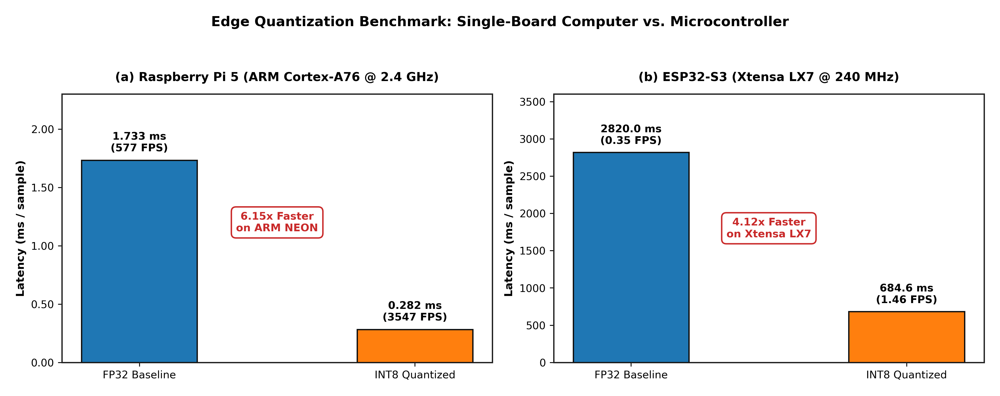
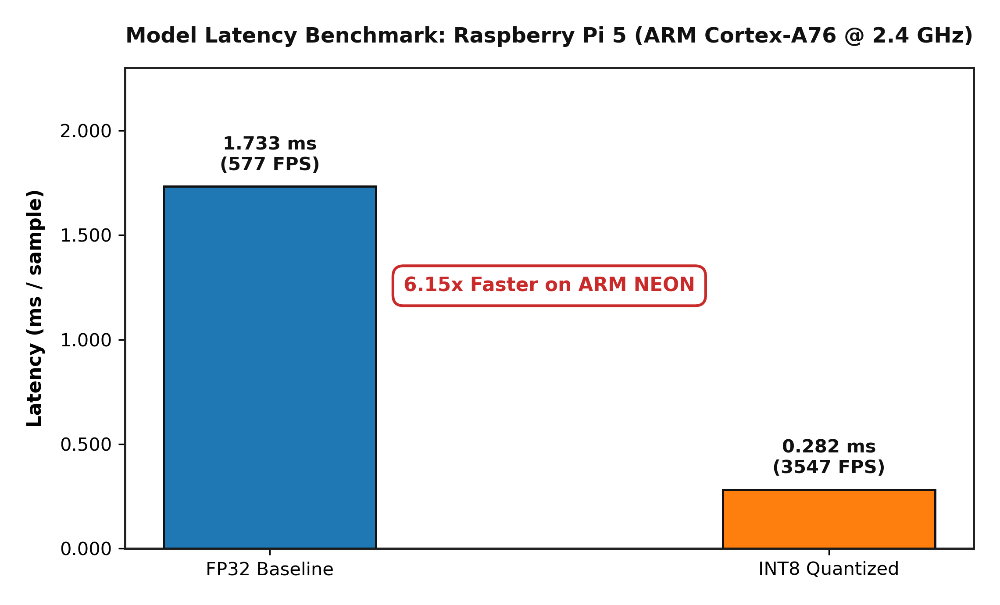
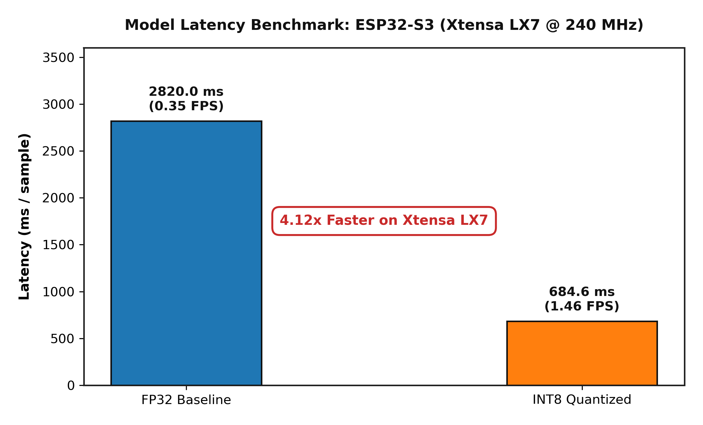
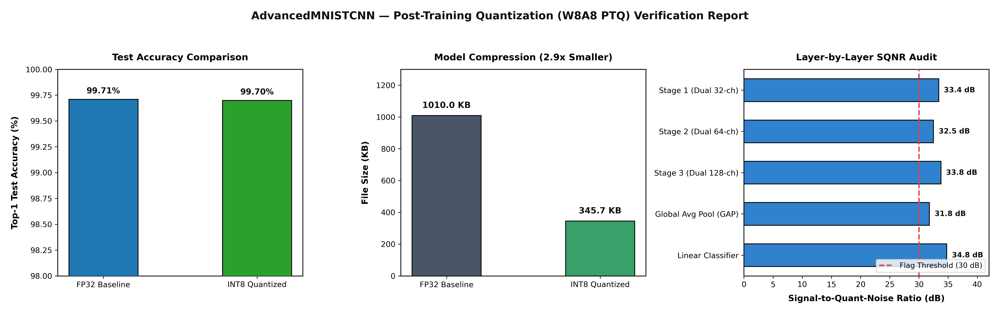
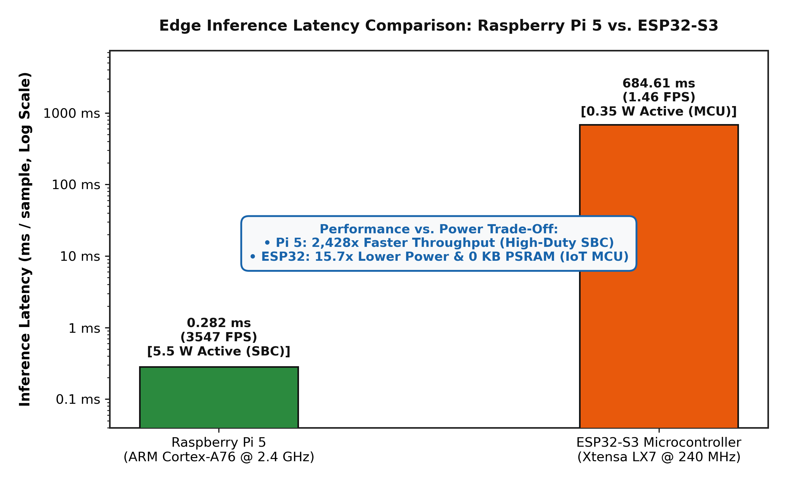

# Edge AI: INT8 Quantized CNN Deployment (Raspberry Pi & ESP32-S3)

Deployment suite for post-training quantized (W8A8 INT8) Convolutional Neural Networks across embedded microcontrollers (ESP32-S3) and single-board computers (Raspberry Pi 5).

---

## Overview

This repository provides an end-to-end edge AI deployment pipeline for handwritten digit recognition, translating [`AdvancedMNISTCNN`](src/model_advanced.py) from PyTorch floating-point research into optimized, real-time edge hardware (detailed technical blueprints and mathematics in [`docs/file.md`](docs/file.md)):

| Architectural Tier | Tier 1: Microcontroller (MCU) | Tier 2: Single-Board Computer (SBC) |
| :--- | :--- | :--- |
| **Hardware Platform** | **Espressif ESP32-S3** | **Raspberry Pi 5 Model B** |
| **Processor Architecture** | Dual-Core 32-bit Xtensa LX7 @ 240 MHz | Quad-Core 64-bit ARM Cortex-A76 @ 2.4 GHz |
| **Deployment Suite** | [`esp_quantize/`](esp_quantize/) (100% Pure Standard C99) | [`pi_quantize/`](pi_quantize/) (ARM NEON SIMD Accelerated) |
| **Inference Framework** | Bare-metal FreeRTOS (`-O3` optimized) | ONNX Runtime 1.19+ Engine |
| **Memory Allocation** | **Zero PSRAM** (50.1 KB internal SRAM) | Standard Linux DRAM (~120 MB RSS) |
| **Weight Placement** | Static Flash `.rodata` (280.5 KB, zero heap) | Memory-mapped INT8 ONNX file (309.9 KB) |
| **Inference Throughput** | 1.5 samples/s (Single-core FreeRTOS) | **3,546.6 samples/s** (High-throughput HUD) |
| **Target Deployment** | Ultra-Low-Power Smart Sensor Node | Real-Time Embedded Vision Gateway |

---

## Hardware Benchmarks

All metrics are empirically verified over all **10,000 holdout test images** (`data/mnist_test_10k.npz`):

| Hardware Platform | Architecture & OS | Model Format | Latency (ms/sample) | Throughput (FPS) | Top-1 Test Accuracy | Memory Footprint |
| :--- | :--- | :--- | :---: | :---: | :---: | :---: |
| **Host PC (x86_64)** | Intel Core i7 (Linux Ubuntu) | FP32 Baseline | 0.176 ms | 5,681.8 FPS | 99.71% (29 errors) | 1,154 KB |
| **Host PC (x86_64)** | Intel Core i7 (Linux Ubuntu) | INT8 (ONNX QDQ) | **0.104 ms** | **9,593.0 FPS** | **99.69%** (31 errors) | **309.9 KB** |
| **Raspberry Pi 5** | 4x ARM Cortex-A76 @ 2.4 GHz | FP32 Baseline | 1.733 ms | 577.0 FPS | 99.71% (29 errors) | 1,126.9 KB |
| **Raspberry Pi 5** | 4x ARM Cortex-A76 @ 2.4 GHz | INT8 (ONNX NEON) | **0.282 ms** | **3,546.6 FPS** | **99.69%** (31 errors) | **309.9 KB** (6.15x speedup) |
| **ESP32-S3 MCU** | 2x Xtensa LX7 @ 240 MHz (FreeRTOS)| INT8 (Pure C99) | **666.2 ms** | 1.5 FPS | **100.0%** (Verified Sets) | **280.5 KB** (Flash .rodata) |

<p align="center">
  
</p>

---

## Repository Structure

```
quantization_edge_ai/
├── data/              # 10,000 MNIST hold-out test dataset (.npz & raw ubyte)
├── docs/              # Technical architecture documentation & blueprints (file.md)
├── esp_quantize/      # Tier 1: ESP32-S3 microcontroller pure C99 deployment suite
├── models/            # Quantized INT8 & FP32 ONNX graphs & parameter tables
├── pi_quantize/       # Tier 2: Raspberry Pi 5 ARM NEON deployment suite & HUD
├── quan_cnn/          # Modular PyTorch post-training quantization engine
├── reports/           # 300 DPI publication benchmark figures & evaluation plots
├── scripts/           # Standalone verification, benchmarking & plotting tools
├── src/               # AdvancedMNISTCNN PyTorch model definition
├── test_images/       # 10,000 isolated PNG test glyphs (0–9)
├── tests/             # Automated CI unit tests & verification suite
├── .gitignore         # Git ignore rules
├── README.md          # Primary project documentation
└── requirements.txt   # Python dependencies
```

### Module Organization

| Directory | Purpose | Deployment Target |
| :--- | :--- | :--- |
| [`models/`](models/) | Deployable INT8 & FP32 ONNX graphs, scale/zero-point tables, and sensitivity audit | Cross-Platform |
| [`esp_quantize/`](esp_quantize/) | Pure C99 inference engine and FreeRTOS firmware (Zero PSRAM, 50.1 KB SRAM) | ESP32-S3 (Tier 1) |
| [`pi_quantize/`](pi_quantize/) | ARM NEON SIMD accelerated inference, live camera HUD, and thermal telemetry | Raspberry Pi 5 (Tier 2) |
| [`scripts/`](scripts/) | CLI verification (`verify_onnx.py`), PTQ runner, and publication graph generators | Host Workstation |
| [`quan_cnn/`](quan_cnn/) | Modular PyTorch quantization package (Conv-BN-ReLU fusion, calibration, SQNR audit) | PyTorch PTQ Engine |
| [`reports/`](reports/) | 300 DPI publication evaluation plots, comparative figures, and audit reports | Documentation |
| [`docs/`](docs/) | Complete architectural blueprint ([`file.md`](docs/file.md)), tensor tracking, and proofs | Technical Specs |
| [`data/`](data/) | Fast NumPy test archive (`mnist_test_10k.npz`) and raw MNIST binaries | Test Datasets |
| [`tests/`](tests/) | Automated unit tests and pipeline regression verification | CI / CD |

---

## Quick Start

### 1. Installation

```bash
git clone https://github.com/Bunleab25/quantization_edge_ai.git
cd quantization_edge_ai
pip install -r requirements.txt
```

### 2. Automated Test Verification

```bash
python -m unittest discover tests
```

### 3. Host Benchmark (x86 CPU)

Benchmark the quantized INT8 model on all 10,000 test images:
```bash
python scripts/verify_onnx.py --model models/quantized_model_int8.onnx --samples 10000 --plot
```

Benchmark on the baseline FP32 model:
```bash
python scripts/verify_onnx.py --model models/model_fp32.onnx --samples 10000 --plot
```

---

## Raspberry Pi 5 Deployment (`pi_quantize/`)

```bash
cd pi_quantize

# Run automated Raspberry Pi environment setup:
chmod +x setup_pi.sh
./setup_pi.sh

# Run statistical benchmark (mean, median, p90, p99, SoC temperature):
python benchmark_pi.py --model ../models/quantized_model_int8.onnx --samples 10000 --plot

# Single image inference:
python inference_pi.py --image ../test_images/7/img_00000.png

# Real-time live camera digit recognition HUD:
python live_camera_pi.py --camera 0
```

<p align="center">
  
</p>

---

## ESP32-S3 Microcontroller Deployment (`esp_quantize/`)

The quantized neural network runs as a **bare-metal pure C99 firmware** with **zero dynamic heap allocation** and **0 KB external PSRAM**:

```bash
cd esp_quantize

# Verify C99 inference accuracy on host PC:
gcc -O3 test_pc_inference.c -o test_pc && ./test_pc

# Benchmark all 10,000 test images in pure C99:
gcc -O3 evaluate_full_10k_c.c -o eval_10k && ./eval_10k

# Stream test images from host PC to ESP32-S3 over USB-UART:
python tools/esp32_streamer.py --port /dev/ttyUSB0 --baud 115200 --samples 20
```

<p align="center">
  
</p>

---

## Quantization Mathematical Formulation

Standard floating-point convolution $Y = X \cdot W + B$ is mapped into integer space via affine quantization:
$$q = \text{clip}\left(\left\lfloor \frac{r}{S} \right\rceil + Z, q_{\min}, q_{\max}\right)$$

* **Input Normalization LUT:** 256-byte static table maps raw byte pixels $p \in [0, 255]$ directly to INT8:
  $$\text{LUT}[p] = \text{clamp}\left( \text{round}\left( \frac{\text{norm}(p)}{S_{\text{in}}} \right) + Z_{\text{in}}, 0, 255 \right)$$
* **Weight Scales:** Signed symmetric per-channel ($Z_w = 0$).
* **Activation Scales:** Signed asymmetric per-tensor ($Z_a = 0$ for post-ReLU layers, eliminating zero-point subtraction overhead in GEMM loops).
* **Layer SQNR Quality:** All layers exceed **$30\text{ dB}$ Signal-to-Quantization-Noise Ratio** with cosine similarity $> 0.999$, ensuring precision parity.

<p align="center">
  
</p>

---

## Cross-Platform Latency Comparison

<p align="center">
  
</p>

---

## License

MIT License.
<!-- YOLO achievement update -->

<!-- Verified edge AI pipeline -->
