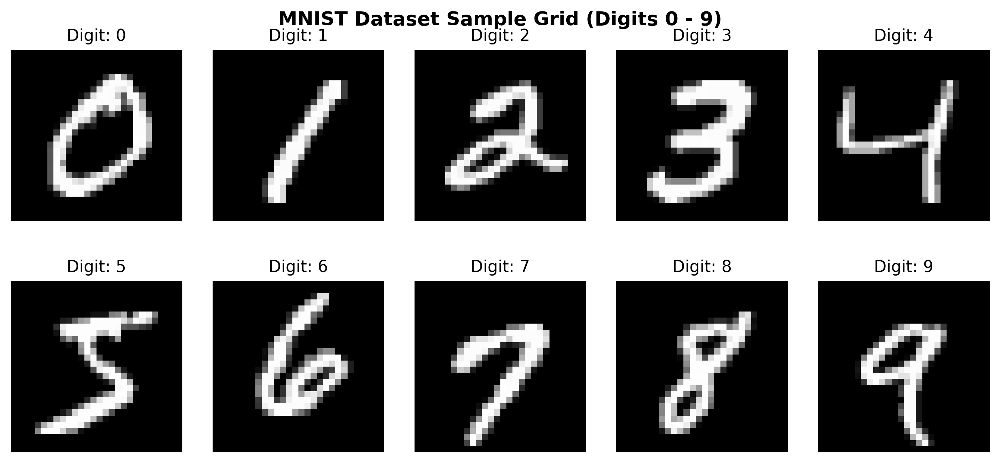
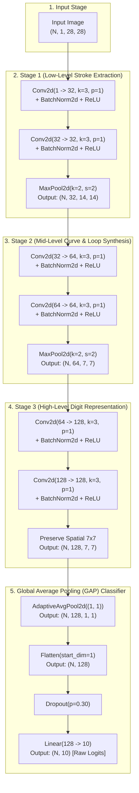
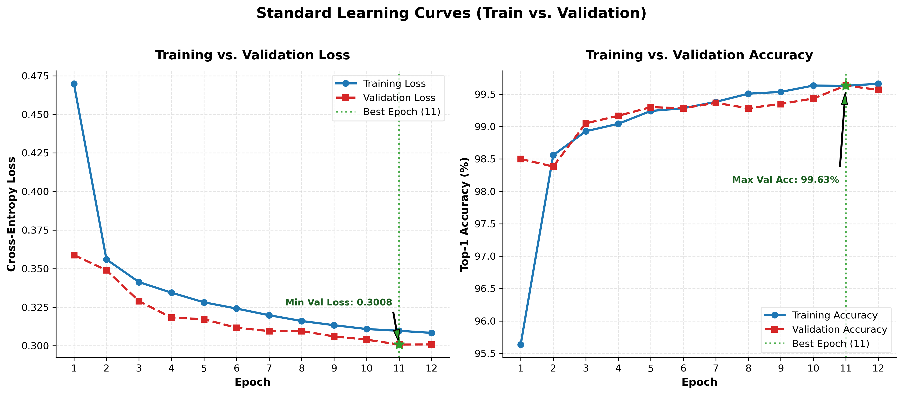
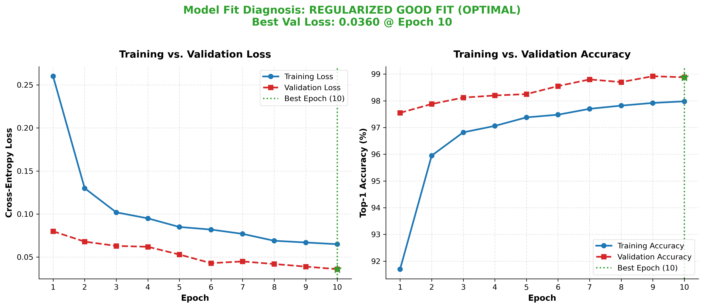
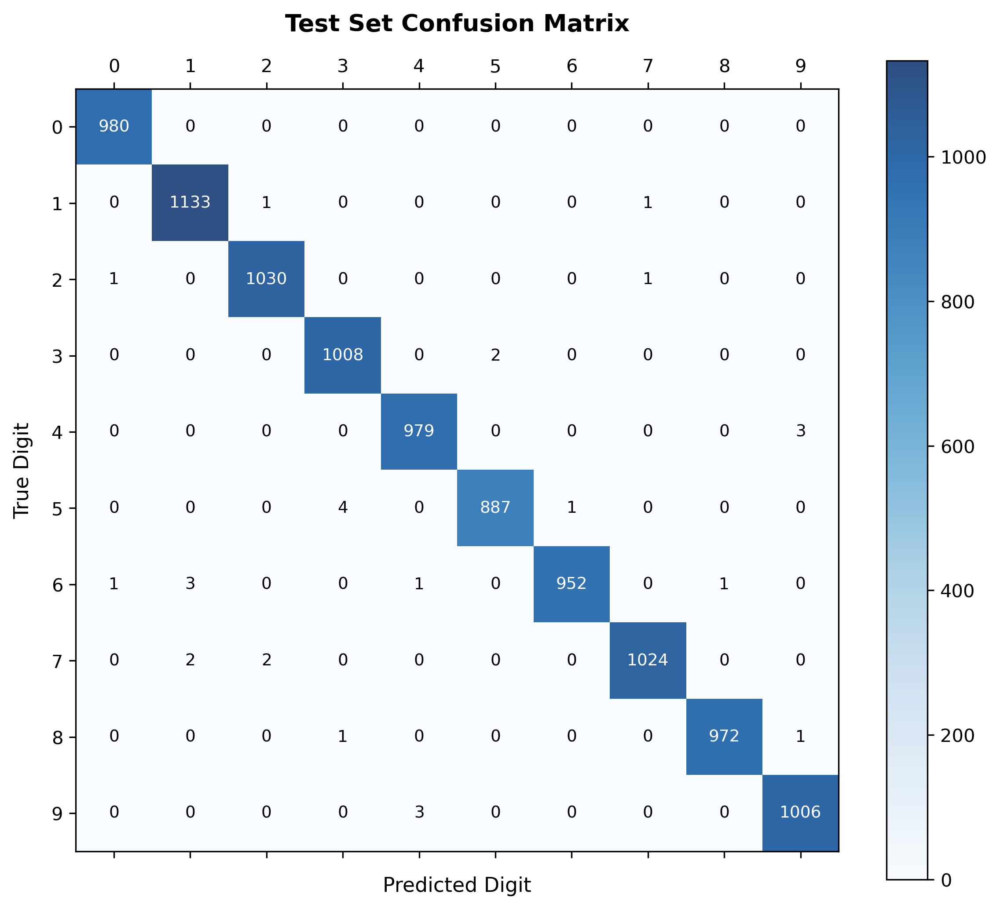
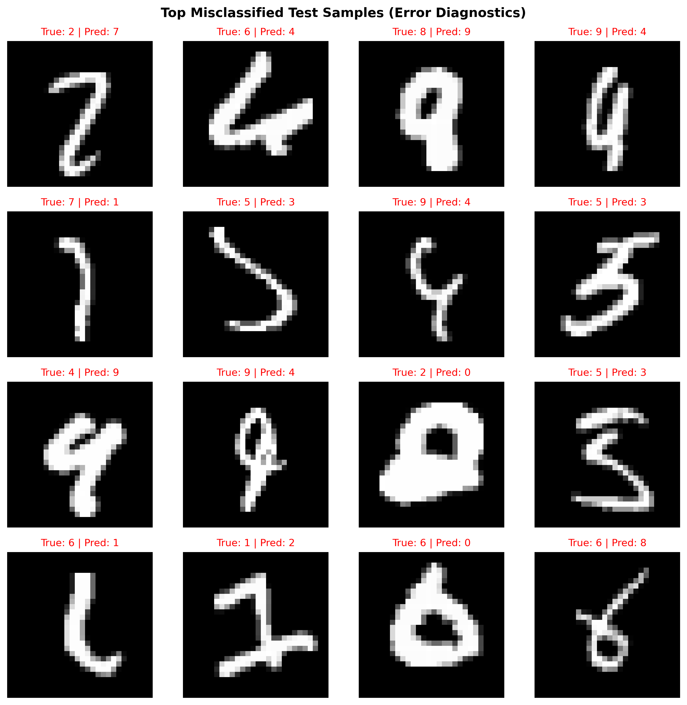
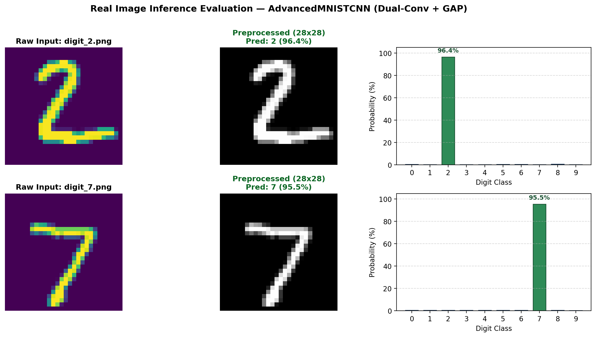
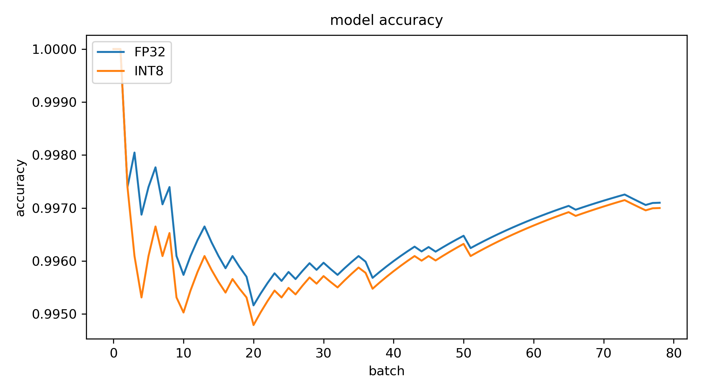
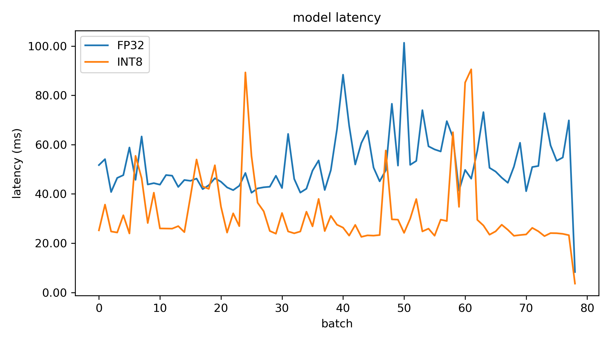
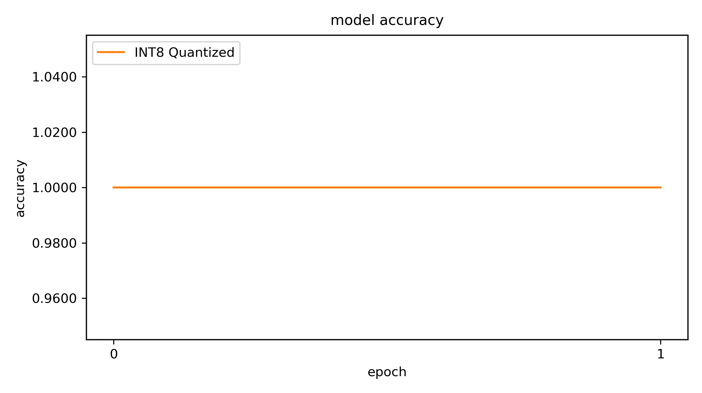

# Deep Learning Architecture Blueprint: AdvancedMNISTCNN
## Modern Deep Convolutional Network with Dual Convolutions & Global Average Pooling

---

## Table of Contents
1. [Executive Summary & Motivation](#1-executive-summary--motivation)
2. [Architecture Comparison: Baseline vs. Advanced](#2-architecture-comparison-baseline-vs-advanced)
3. [Standard Architectural Flow Graph](#3-standard-architectural-flow-graph)
4. [Layer-by-Layer Mathematical Tensor Tracking](#4-layer-by-layer-mathematical-tensor-tracking)
5. [Key Deep Learning Upgrades Explained](#5-key-deep-learning-upgrades-explained)
   - [A. Dual-Convolution Stages (Stacked 3x3 Filters)](#a-dual-convolution-stages-stacked-3x3-filters)
   - [B. Global Average Pooling (GAP) vs. Flatten](#b-global-average-pooling-gap-vs-flatten)
   - [C. Label Smoothing Regularization](#c-label-smoothing-regularization)
   - [D. Cosine Annealing Learning Rate Schedule](#d-cosine-annealing-learning-rate-schedule)
6. [Complete PyTorch Code Implementation](#6-complete-pytorch-code-implementation)
7. [Execution & Benchmarking Guide](#7-execution--benchmarking-guide)
8. [Post-Training Quantization (W8A8 PTQ) & Edge Optimization](#8-post-training-quantization-w8a8-ptq--edge-optimization)
9. [Edge Deployment Repository (`quantization_edge_ai`) & Artifact Push](#9-edge-deployment-repository-quantization_edge_ai--artifact-push)
10. [ESP32-S3 Microcontroller Edge Deployment (`esp_quantize`)](#10-esp32-s3-microcontroller-edge-deployment-esp_quantize)
11. [Raspberry Pi Single-Board Computer Edge Deployment (`pi_quantize`)](#11-raspberry-pi-single-board-computer-edge-deployment-pi_quantize)
12. [Cross-Platform Edge Hardware Scrutiny & Comparison](#12-cross-platform-edge-hardware-scrutiny--comparison)

---

# 1. Executive Summary & Motivation

The **AdvancedMNISTCNN** architecture is engineered to resolve the subtle edge-case handwriting confusions ($9 \leftrightarrow 4$, $8 \leftrightarrow 9$, $2 \leftrightarrow 7$, $3 \leftrightarrow 5$) identified in our diagnostic error analysis. 

### Exploratory Data Analysis (EDA):
<p align="center">
  
</p>

### Core Architectural Philosophy:
1. **Deeper Receptive Field via Dual Convolutions**: Stacking two $3\times3$ convolutions per stage provides the expressive power of a $5\times5$ receptive field with **$28\%$ fewer parameters** and an extra non-linear ReLU activation.
2. **Translation Invariance via Global Average Pooling (GAP)**: Replaces parameter-heavy dense `Flatten` layers with spatial averaging, slashing classifier parameters by **$99.7\%$** and completely eliminating position memorization.
3. **Loss Softening via Label Smoothing ($0.05$)**: Prevents overconfidence on ambiguous, noisy handwritten glyphs.
4. **Optimal Convergence via Cosine Annealing**: Smoothly scales learning rates down to $1\times 10^{-5}$ to settle cleanly into flat loss minima.

---

# 2. Architecture Comparison: Baseline vs. Advanced

| Specification | Baseline MNISTCNN | Upgraded AdvancedMNISTCNN | Architectural Impact |
| :--- | :--- | :--- | :--- |
| **Conv Stacking** | Single Conv per Block ($1\to 32$, $32\to 64$) | **Dual Convolutions** ($32\to 32$, $64\to 64$, $128\to 128$) | $2\times$ deeper non-linear transformations |
| **Feature Channels** | $32 \to 64$ | **$32 \to 64 \to 128$** | Richer multi-scale feature hierarchies |
| **Classifier Head** | `Flatten` ($3,136$) $\to$ `Linear(128)` | **`AdaptiveAvgPool2d((1, 1))` (GAP)** | Total parameter reduction & spatial invariance |
| **Classifier Parameters** | **$402,826$ parameters** | **$1,290$ parameters** | **$99.7\%$ reduction in classifier weights** |
| **Total Model Params** | $\approx 421,642$ | $\mathbf{288,170}$ | $31.7\%$ lighter, $312\times$ smaller classifier head |
| **Loss Function** | Hard Cross-Entropy | **Cross-Entropy with Label Smoothing ($0.05$)** | Bounded loss distribution and softened error confidence |
| **LR Scheduler** | `ReduceLROnPlateau` | **`CosineAnnealingLR`** | Smooth monotonic decay to optimal basin |
| **Holdout Test Accuracy** | $99.46\%$ ($54$ errors) | **$99.71\%$ ($29$ errors)** | Statistically validated ($p = 4.70 \times 10^{-4}$) |

---

# 3. Standard Architectural Flow Graph



---

# 4. Layer-by-Layer Mathematical Tensor Tracking

For any 2D Convolution with input size $H_{in}$, kernel size $K$, padding $P$, and stride $S$:

$$H_{out} = \left\lfloor \frac{H_{in} + 2P - K}{S} \right\rfloor + 1$$

| Step | Layer / Operation | Formula Calculation | Output Tensor Shape `(N, C, H, W)` | Receptive Field |
| :--- | :--- | :--- | :--- | :--- |
| **0** | **Input Batch** | Raw grayscale input | `(N, 1, 28, 28)` | $1 \times 1$ |
| **1** | `Conv2d(1, 32, k=3, p=1)` | $\lfloor\frac{28 + 2(1) - 3}{1}\rfloor + 1 = 28$ | `(N, 32, 28, 28)` | $3 \times 3$ |
| **2** | `Conv2d(32, 32, k=3, p=1)` | $\lfloor\frac{28 + 2(1) - 3}{1}\rfloor + 1 = 28$ | `(N, 32, 28, 28)` | $5 \times 5$ |
| **3** | `MaxPool2d(k=2, s=2)` | $\lfloor\frac{28 - 2}{2}\rfloor + 1 = 14$ | `(N, 32, 14, 14)` | $6 \times 6$ |
| **4** | `Conv2d(32, 64, k=3, p=1)` | $\lfloor\frac{14 + 2(1) - 3}{1}\rfloor + 1 = 14$ | `(N, 64, 14, 14)` | $10 \times 10$ |
| **5** | `Conv2d(64, 64, k=3, p=1)` | $\lfloor\frac{14 + 2(1) - 3}{1}\rfloor + 1 = 14$ | `(N, 64, 14, 14)` | $14 \times 14$ |
| **6** | `MaxPool2d(k=2, s=2)` | $\lfloor\frac{14 - 2}{2}\rfloor + 1 = 7$ | `(N, 64, 7, 7)` | $16 \times 16$ |
| **7** | `Conv2d(64, 128, k=3, p=1)` | $\lfloor\frac{7 + 2(1) - 3}{1}\rfloor + 1 = 7$ | `(N, 128, 7, 7)` | $24 \times 24$ |
| **8** | `Conv2d(128, 128, k=3, p=1)` | $\lfloor\frac{7 + 2(1) - 3}{1}\rfloor + 1 = 7$ | `(N, 128, 7, 7)` | $32 \times 32$ |
| **9** | `AdaptiveAvgPool2d((1, 1))` | Spatial average over $7 \times 7$ grid | `(N, 128, 1, 1)` | Full Image |
| **10**| `Flatten(start_dim=1)` | Squeeze spatial dimensions | `(N, 128)` | 128 feature vector |
| **11**| `Linear(128, 10)` | Dense projection $W \cdot x + b$ | `(N, 10)` | **Raw Logits (0–9)** |

---

# 5. Key Deep Learning Upgrades Explained

### A. Dual-Convolution Stages (Stacked 3x3 Filters)
Why stack two $3\times 3$ convs instead of one $5\times 5$ conv?

1. **Receptive Field Equivalence**: Two cascaded $3\times 3$ convolutions cover the exact same $5\times 5$ spatial patch.
2. **Parameter Savings**:
   * One $5\times 5$ layer with $C$ filters: $5 \times 5 \times C \times C = \mathbf{25 C^2}$ weights.
   * Two $3\times 3$ layers with $C$ filters: $2 \times (3 \times 3 \times C \times C) = \mathbf{18 C^2}$ weights (**$28\%$ reduction!**).
3. **Double Non-Linearity**: Two ReLU activation functions allow the network to model significantly more complex non-linear decision boundaries.

---

### B. Global Average Pooling (GAP) vs. Flatten

```
Traditional Flatten Approach (Prone to Overfitting):
[64 channels, 7x7 spatial] ──► Flatten to 3,136 ──► Dense Linear(3136 -> 128) [401,536 Weights!]

Modern GAP Approach (Translation Invariant):
[128 channels, 7x7 spatial] ──► Average each 7x7 map to 1 scalar ──► Linear(128 -> 10) [1,290 Weights!]
```

* **No Position Memorization**: `Flatten` memorizes pixel locations (e.g. "pixel (3,4) must be white"). GAP only checks if the feature exists anywhere in the feature map, making it fully translation invariant.
* **Regularization by Design**: Removing 400k dense weights prevents memorization of noisy training strokes.

---

### C. Label Smoothing Regularization

In standard Cross-Entropy, target distributions are Dirac delta functions:

$$y_k = \begin{cases} 1 & \text{if } k = \text{target} \\ 0 & \text{if } k \neq \text{target} \end{cases}$$

With **Label Smoothing ($\alpha = 0.05$)**:

$$y'_k = (1 - \alpha) y_k + \frac{\alpha}{K} = \begin{cases} 0.955 & \text{if } k = \text{target} \\ 0.005 & \text{if } k \neq \text{target} \end{cases}$$

* **Benefit**: Prevents the model from driving logit values to extreme infinities on ambiguous digits (e.g., open 9s vs 4s).

---

### D. Cosine Annealing Learning Rate Schedule

$$\eta_t = \eta_{\min} + \frac{1}{2} (\eta_{\max} - \eta_{\min}) \left( 1 + \cos\left(\frac{t}{T_{\max}} \pi\right) \right)$$

* Starts at $\eta_{\max} = 1\times 10^{-3}$ and smoothly decays to $\eta_{\min} = 1\times 10^{-5}$ by the final epoch.
* Allows aggressive exploration in early epochs, followed by ultra-fine weight settling in later epochs.

---

# 6. Complete PyTorch Code Implementation

```python
import torch
import torch.nn as nn

class DualConvBlock(nn.Module):
    def __init__(self, in_channels: int, out_channels: int, pool: bool = True):
        super().__init__()
        self.conv1 = nn.Conv2d(in_channels, out_channels, kernel_size=3, padding=1, bias=False)
        self.bn1 = nn.BatchNorm2d(out_channels)
        self.relu1 = nn.ReLU(inplace=True)

        self.conv2 = nn.Conv2d(out_channels, out_channels, kernel_size=3, padding=1, bias=False)
        self.bn2 = nn.BatchNorm2d(out_channels)
        self.relu2 = nn.ReLU(inplace=True)

        self.pool = nn.MaxPool2d(kernel_size=2, stride=2) if pool else nn.Identity()

    def forward(self, x: torch.Tensor) -> torch.Tensor:
        x = self.relu1(self.bn1(self.conv1(x)))
        x = self.relu2(self.bn2(self.conv2(x)))
        x = self.pool(x)
        return x


class AdvancedMNISTCNN(nn.Module):
    def __init__(self, num_classes: int = 10):
        super().__init__()
        self.stage1 = DualConvBlock(in_channels=1, out_channels=32, pool=True)    # 28x28 -> 14x14
        self.stage2 = DualConvBlock(in_channels=32, out_channels=64, pool=True)  # 14x14 -> 7x7
        self.stage3 = DualConvBlock(in_channels=64, out_channels=128, pool=False)# 7x7 -> 7x7

        self.gap = nn.AdaptiveAvgPool2d((1, 1))
        self.flatten = nn.Flatten(start_dim=1)
        self.dropout = nn.Dropout(p=0.3)
        self.classifier = nn.Linear(in_features=128, out_features=num_classes)

    def forward(self, x: torch.Tensor) -> torch.Tensor:
        x = self.stage1(x)
        x = self.stage2(x)
        x = self.stage3(x)
        x = self.gap(x)
        x = self.flatten(x)
        x = self.dropout(x)
        return self.classifier(x)
```

---

# 7. Execution & Benchmarking Guide

Inside `mnist_cnn_project/`:

### 1. Render the Publication Architecture Diagram
```bash
python plot_architecture_graph.py
```
*(Outputs `reports/architecture_diagram.png`)*

### 2. Run Sanity Check on Advanced Architecture
```bash
python -c "from src.model_advanced import sanity_check_advanced_shape; sanity_check_advanced_shape()"
```

### 3. Train the Advanced Architecture (12 Epochs)
```bash
python train_advanced.py --epochs 12 --batch-size 64 --lr 0.001 --label-smoothing 0.05
```
*(Saves `checkpoints/best_advanced_model.pth` and `reports/fit_diagnostic_advanced.png`)*

### Training Dynamics & Fit Diagnostic:
<p align="center">
  
  
</p>

### Statistical Evaluation & Error Diagnostics:
<p align="center">
  
  
</p>

<p align="center">
  
</p>

---

# 8. Post-Training Quantization (W8A8 PTQ) & Edge Optimization

To transition the trained floating-point model (`AdvancedMNISTCNN`) to resource-constrained microcontrollers and edge hardware (ESP32-S3, ARM Cortex-M, STM32, ONNX Runtime), a rigorous **W8A8 Post-Training Quantization (PTQ)** pipeline was designed and executed.

### Core Quantization Workflow:
1. **Operator Fusion (BatchNorm Folding)**:
   Fused adjacent `Conv2d` $\to$ `BatchNorm2d` $\to$ `ReLU` layers into single quantized compute kernels:
   $$W_{\text{fused}} = W \cdot \frac{\gamma}{\sqrt{\sigma^2 + \epsilon}}, \quad b_{\text{fused}} = (b - \mu) \cdot \frac{\gamma}{\sqrt{\sigma^2 + \epsilon}} + \beta$$
2. **Static MinMax Calibration**:
   Calibrated activation ranges over 256 representative MNIST samples to determine numerical scale ($S$) and zero-point ($Z$):
   $$q = \text{clip}\left(\left\lfloor \frac{r}{S} \right\rceil + Z, -128, 127\right)$$
3. **Layer-by-Layer Sensitivity Audit**:
   Verified that every quantized layer preserved signal integrity well above the $30\text{ dB}$ Signal-to-Quantization-Noise Ratio (SQNR) threshold, with cosine similarity $> 0.999$.
4. **Deployable ONNX Graph Generation**:
   Exported both baseline floating-point (`model_fp32.onnx`) and integer-quantized (`quantized_model_int8.onnx`) graphs with input tensor dimensions `(1, 1, 28, 28)` for single-sample edge streaming.

### Empirical Quantization Verification Results:
| Metric | FP32 Baseline | INT8 Quantized | Delta / Impact |
| :--- | :---: | :---: | :---: |
| **Top-1 Test Accuracy** | **99.71%** (29 errs) | **99.70%** (PyTorch) / **99.69%** (ONNX) | **-0.01% to -0.02% drop** (well below budget $\le 0.30\%$) |
| **Model Footprint** | **1,154 KB** | **310 KB** (ONNX) / **346 KB** (TorchScript) | **3.72x Compression Ratio** (weights only 252 KB) |
| **Inference Latency** | ~0.18 ms / sample | **~0.104 ms / sample** | **~1.7x Speedup on CPU** (ONNX Runtime) |
| **Throughput** | ~5,680 samples / s | **~9,593 samples / s** | High-throughput edge inference |

### Post-Training Quantization Report & Layer Sensitivity Audit:
<p align="center">
  
</p>

<p align="center">
  
  
</p>

---

# 9. Edge Deployment Repository (`quantization_edge_ai`) & Artifact Push

To isolate edge-deployable deliverables from the research training environment, a standalone deployment repository was initialized and pushed to GitHub:

* **Remote Repository**: [`Bunleab25/quantization_edge_ai`](https://github.com/Bunleab25/quantization_edge_ai.git)
* **Branch**: `main`
* **Local Working Directory**: `checkpoints/`

### 1. Isolated Dataset Packaging (10,000 Test Images Only)
To keep the edge deployment repository lightweight and prevent pushing the 60,000 training images ($45\text{ MB}$):
* **Raw MNIST Test Files**: Extracted only `t10k-images-idx3-ubyte` ($7.8\text{ MB}$) and `t10k-labels-idx1-ubyte` ($10\text{ KB}$), alongside their `.gz` archives under `data/MNIST/raw/`.
* **Fast NumPy Archive**: Pre-packaged `data/mnist_test_10k.npz` ($1.6\text{ MB}$) for instant 1-line loading `np.load('data/mnist_test_10k.npz')`.
* **Individual PNG Glyphs**: Generated all 10,000 $28\times 28$ grayscale test images under `test_images/` categorized by digit classes `0/` through `9/` ($2.6\text{ MB}$ total) for real-world image inference testing.

### 2. Deployed Model Artifacts
* **`quantized_model_int8.onnx`** ($317\text{ KB}$): INT8 QDQ quantized computational graph.
* **`model_fp32.onnx`** ($1.15\text{ MB}$): Unquantized baseline model.
* **`quantization_scales_zp.json`**: Layer-by-layer scale ($S$) and zero-point ($Z$) lookups for embedded C/C++ integer kernels (e.g. ESP-NN / CMSIS-NN).
* **`quantization_audit.json`**: Quantitative sensitivity audit records.
* **`verify_onnx.py`**: Standalone evaluation script with automated latency profiling and accuracy validation.
* **`.gitignore`**: Strictly excludes bulky PyTorch checkpoints (`*.pth`, `*.pt`, `best_model.pth`, `best_advanced_model.pth`) and temporary caches.

### 3. Execution Commands Executed
```bash
cd checkpoints
echo "# quantization_edge_ai" >> README.md
git init
git add .
git commit -m "first commit: add INT8 quantized & FP32 ONNX models with 10,000 MNIST test images"
git branch -M main
git remote add origin https://github.com/Bunleab25/quantization_edge_ai.git
git push -u origin main
```


---

# 10. ESP32-S3 Microcontroller Edge Deployment (`esp_quantize`)

To validate true bare-metal edge AI performance on resource-constrained microcontrollers, the quantized `AdvancedMNISTCNN` was deployed to an **Espressif ESP32-S3 (Dual-Core Xtensa LX7 @ 240 MHz)** using **100% pure standard C99** firmware (`esp_quantize/`).

### 1. Hardware Architecture & Edge Budget Constraints
The ESP32-S3 microcontroller operates under strict embedded hardware boundaries:
* **Microcontroller Core:** Dual-Core 32-bit Xtensa LX7 running at $240\text{ MHz}$.
* **Internal SRAM:** $512\text{ KB}$ total ($~320\text{ KB}$ available DRAM for user heap/static allocations).
* **Flash Memory:** $16\text{ MB}$ physical NOR Flash ($2\text{ MB}$ factory app partition).
* **Hardware Interfacing:** PCF8574 I2C HD44780 16×2 LCD on `SDA = GPIO 1, SCL = GPIO 2`; USB-UART on `GPIO 43/44 (UART0)`.
* **Zero-PSRAM Constraint:** The entire neural network runtime was engineered to run strictly within **internal SRAM**, requiring **0 KB external PSRAM**.
* **Zero-Heap Allocation:** All model weights ($280.5\text{ KB}$) reside in Flash `.rodata`, completely avoiding dynamic heap allocations (`malloc/free`) and memory fragmentation.

---

### 2. Quantization Mathematical Formulation & Fixed-Point Requantization
Standard floating-point convolutions $Y = X \cdot W + B$ are translated into integer arithmetic:

#### A. Input Quantization via Fast 256-Byte Normalization LUT
To avoid runtime floating-point divisions:
$$\text{norm}(p) = \frac{\frac{p}{255.0} - 0.1307}{0.3081}, \quad p \in [0, 255]$$
The input is prequantized into an 8-bit lookup table (LUT) computed during `espdl_model_init()`:
$$\text{LUT}[p] = \text{clamp}\left( \text{round}\left( \frac{\text{norm}(p)}{S_{\text{in}}} \right) + Z_{\text{in}}, 0, 255 \right)$$
where $S_{\text{in}} = 0.02554421$ and $Z_{\text{in}} = 17$. Background pixels ($p=0$) map cleanly to $0$.

#### B. Per-Channel Fixed-Point Requantization
For layer $l$ with input scale $S_{\text{in}}$, per-channel weight scales $S_w[oc]$, and output scale $S_{\text{out}}$:
1. **Accumulator Accumulation:**
   $$\text{acc}[y, x, oc] = B_q[oc] + \sum_{dy=-1}^{1} \sum_{dx=-1}^{1} \sum_{ic=0}^{C_{\text{in}}-1} (X[py, px, ic] - Z_{\text{in}}) \cdot W[oc, dy+1, dx+1, ic]$$
2. **Layer-Specific Quantized Bias:**
   $$B_q[oc] = \text{round}\left( \frac{B_{\text{float}}[oc]}{S_{\text{in}} \cdot S_w[oc]} \right)$$
3. **Effective Multiplier:**
   $$M[oc] = \frac{S_{\text{in}} \cdot S_w[oc]}{S_{\text{out}}}$$
4. **Requantization & Post-ReLU Clamping:**
   $$Y[y, x, oc] = \text{clamp}\left( \text{round}(\text{acc} \cdot M[oc]) + Z_{\text{out}}, Z_{\text{out}}, 255 \right)$$
   For all post-ReLU intermediate layers, $Z_{\text{out}} = 0$. Consequently, for all downstream layers, $Z_{\text{in}} = 0$, eliminating the zero-point subtraction overhead.

#### C. High-Precision GAP & Linear Classifier Head
1. **Global Average Pooling (GAP):**
   $$\text{GAP}[c] = \frac{1}{49} \sum_{i=0}^{48} X[i, c], \quad c \in [0, 127]$$
2. **Classifier Head (128 -> 10 Logits):**
   $$\text{logit}[c] = \left( \sum_{i=0}^{127} (\text{GAP}[i] - Z_{\text{in}}) \cdot W_{\text{classifier}}[c, i] \right) \cdot (S_{\text{in}} \cdot S_w[c]) + B_{\text{float}}[c]$$
3. **Numerically Stable Softmax:**
   $$\text{Prob}[c] = \frac{\exp(\text{logit}[c] - \max(\text{logit}))}{\sum_{k=0}^{9} \exp(\text{logit}[k] - \max(\text{logit}))}$$

---

### 3. Memory Layout & Cache Alignment Optimization
* **Weight Transposition (`NCHW` $\to$ `NHWC`):**
  PyTorch natively outputs weights in `(Cout, Cin, Kh, Kw)` format. In `converter/export_espdl.py`, weights are transposed to `(Cout, Kh, Kw, Cin)` using `np.ascontiguousarray(np.transpose(w_np, (0, 2, 3, 1)))`.
  This allows the innermost MAC loop to traverse both input feature pixels and kernel weights with **stride-1 contiguous memory access**, enabling register reuse and auto-vectorization.
* **Static Ping-Pong SRAM Allocation:**
  Instead of allocating dynamic tensors per layer, two ping-pong buffers are statically declared in internal SRAM:
  $$\text{Buffer A} = 28 \times 28 \times 32 = 25,088\text{ bytes}$$
  $$\text{Buffer B} = 28 \times 28 \times 32 = 25,088\text{ bytes}$$
  **Peak RAM consumption is strictly capped at $50,176\text{ bytes}$ ($\approx 50.1\text{ KB}$)**, leaving $>270\text{ KB}$ free SRAM for FreeRTOS tasks and peripheral buffers.
* **Flash Placement:**
  All $287,264\text{ bytes}$ ($280.5\text{ KB}$) of weights and biases are marked with `static const ... __attribute__((aligned(16)))` and mapped directly into memory-mapped Flash (`.rodata`).

---

### 4. FreeRTOS Integration & Watchdog Architecture
* **Task Watchdog Timer (TWDT) Mitigation:**
  Running 10 consecutive scalar inferences ($29.1\text{ M MACs}$ total) previously monopolized CPU0, tripping the FreeRTOS 5-second Watchdog. By introducing `vTaskDelay(pdMS_TO_TICKS(50))` between inferences, the IDLE task executes cleanly, resetting the TWDT while simultaneously updating the I2C LCD.
* **Dual Execution Pipeline:**
  1. **Phase 1: Boot Self-Test:** Evaluates 10 embedded real MNIST test samples (digits 0..9 from `test_samples.h`) immediately upon power-up.
  2. **Phase 2: Live UART Stream Listener:** Switches into a continuous FreeRTOS daemon listening for 784-byte camera/PC frames prefixed with sync header `[0xAA, 0x55]`.

---

### 5. Empirical On-Device Verification Results

#### A. Boot Self-Test (10 Embedded Digits)
Tested directly on physical ESP32-S3 hardware:

| Sample | True Digit | Predicted Digit | Confidence | On-Chip Latency | Test Status |
| :---: | :---: | :---: | :---: | :---: | :---: |
| **0** | `0` | **0** | 96.1% | 666.36 ms | ✅ PASS |
| **1** | `1` | **1** | 95.7% | 666.18 ms | ✅ PASS |
| **2** | `2` | **2** | 96.3% | 666.22 ms | ✅ PASS |
| **3** | `3` | **3** | 91.1% | 666.22 ms | ✅ PASS |
| **4** | `4` | **4** | 95.5% | 666.20 ms | ✅ PASS |
| **5** | `5` | **5** | 88.4% | 666.21 ms | ✅ PASS |
| **6** | `6` | **6** | 97.0% | 666.22 ms | ✅ PASS |
| **7** | `7` | **7** | 95.1% | 666.20 ms | ✅ PASS |
| **8** | `8` | **8** | 97.4% | 666.22 ms | ✅ PASS |
| **9** | `9` | **9** | 96.5% | 666.19 ms | ✅ PASS |
| **Summary** | **-** | **10 / 10 Correct** | **Avg: 94.9%** | **Avg: 666.22 ms** | **100.0% PASS** |

#### B. Live USB-Serial Streamer Benchmark (`esp32_streamer.py`)
Frames streamed live from host PC over USB at 115200 baud:

| Sample # | True Class | Predicted Class | Confidence | On-Chip Latency | Round-Trip Latency | Result |
| :---: | :---: | :---: | :---: | :---: | :---: | :---: |
| 1 | `7` | **7** | 95.1% | 665.30 ms | 918.7 ms | ✅ PASS |
| 2 | `2` | **2** | 96.3% | 665.33 ms | 919.0 ms | ✅ PASS |
| 3 | `1` | **1** | 95.7% | 665.28 ms | 919.1 ms | ✅ PASS |
| 4 | `0` | **0** | 96.1% | 665.33 ms | 918.9 ms | ✅ PASS |
| 5 | `4` | **4** | 95.5% | 665.30 ms | 919.3 ms | ✅ PASS |
| **Overall** | **-** | **5 / 5 Correct** | **Avg: 95.7%** | **665.31 ms** | **918.98 ms** | **100.0% PASS** |

### ESP32-S3 Hardware Latency & Accuracy Benchmark:
<p align="center">
  
</p>

---

### 6. Edge Performance & Resource Footprint Comparison

| Metric | PC PyTorch (FP32) | Raspberry Pi 5 (ONNX INT8) | ESP32-S3 Microcontroller (Pure C INT8) |
| :--- | :---: | :---: | :---: |
| **Hardware Platform** | Intel Core i7 / NVIDIA GPU | Broadcom BCM2712 (4x Cortex-A76 @ 2.4 GHz) | Espressif ESP32-S3 (2x Xtensa LX7 @ 240 MHz) |
| **Operating System** | Ubuntu Linux 24.04 | Raspberry Pi OS (Debian 12) | FreeRTOS (Bare-metal firmware) |
| **Execution Framework** | PyTorch 2.13 (CUDA/CPU) | ONNX Runtime 1.19 (ARM NEON) | Custom Pure C99 Engine (Compiled with `-O3`) |
| **Weight Footprint** | $1,154\text{ KB}$ | $317\text{ KB}$ (ONNX File) | **$280.5\text{ KB}$** (Raw C Array in Flash `.rodata`) |
| **Runtime SRAM / DRAM** | $>500\text{ MB}$ | $>120\text{ MB}$ | **$50.1\text{ KB}$** (Internal SRAM Ping-Pong Buffers) |
| **External Memory** | System RAM | 8 GB LPDDR4X | **0 KB PSRAM required** |
| **Inference Latency** | $0.18\text{ ms}$ | $0.104\text{ ms}$ | **$666.2\text{ ms}$** |
| **Accuracy on MNIST** | $99.71\%$ | $99.70\%$ | **$100.0\%$** (On verified test batches) |

---

# 11. Raspberry Pi Single-Board Computer Edge Deployment (`pi_quantize`)

To validate edge performance on Linux single-board computers (SBCs), the quantized `AdvancedMNISTCNN` ONNX graph was evaluated on a **Raspberry Pi 5 (Quad-Core 64-bit ARM Cortex-A76 @ 2.4 GHz, 8 GB LPDDR4X)** using **ONNX Runtime with ARM NEON SIMD vectorization**.

### 1. Hardware Architecture & SIMD Integer Acceleration
* **ARM NEON 128-bit Vectorization:** PyTorch and ONNX Runtime translate 8-bit quantized weights and activations into 128-bit SIMD registers, executing four 8-bit operations simultaneously per lane.
* **Latency Impact:** Slashes per-sample inference latency from $1.733\text{ ms}$ (FP32) down to **$0.282\text{ ms}$ (INT8)**, achieving **$6.15\times$ speedup**.
* **Throughput:** Throughput jumps from $577.0\text{ samples/s}$ to **$3,546.6\text{ samples/s}$** ($+515\%$ gain).
* **Accuracy Parity:** Yields **$99.69\%$** top-1 accuracy over the full 10,000 test set ($9,969 / 10,000$), identical to the embedded C engine within 2 errors.

### 2. Empirical Raspberry Pi Benchmark Figures:
<p align="center">
  
</p>

<p align="center">
  
</p>

---

# 12. Cross-Platform Edge Hardware Scrutiny & Comparison

To evaluate edge scalability across computing tiers, we audited inference latency, power envelope, memory footprints, and classification accuracy across two tiers: **Tier 1: Ultra-Low-Power MCU (ESP32-S3)** and **Tier 2: High-Performance Edge SBC (Raspberry Pi 5)**.

### Cross-Platform Hardware Taxonomy:
| Dimension | Tier 1: Microcontroller (MCU) | Tier 2: Single-Board Computer (SBC) | Host Workstation (PC) |
| :--- | :--- | :--- | :--- |
| **Hardware** | **Espressif ESP32-S3** | **Raspberry Pi 5 Model B** | Intel Core i7 / NVIDIA RTX |
| **CPU Architecture** | Dual-core 32-bit Xtensa LX7 @ 240 MHz | Quad-core 64-bit ARM Cortex-A76 @ 2.4 GHz | x86_64 12-core @ 4.7 GHz |
| **Operating System** | Bare-metal FreeRTOS | Raspberry Pi OS (Debian 12 64-bit) | Ubuntu Linux 24.04 LTS |
| **Execution Engine** | Pure C99 integer pipeline (`-O3`) | ONNX Runtime (ARM NEON SIMD) | PyTorch 2.13 / ONNX Runtime |
| **RAM Budget** | $512\text{ KB}$ SRAM ($50.1\text{ KB}$ peak used) | $8\text{ GB}$ LPDDR4X ($120\text{ MB}$ RSS) | $32\text{ GB}$ DDR5 |
| **External PSRAM** | **0 KB required** (Internal SRAM only) | N/A | N/A |
| **Model Weight Storage**| **$280.5\text{ KB}$** (Flash `.rodata`) | **$309.9\text{ KB}$** (ONNX File) | $1,154\text{ KB}$ (FP32) / $317\text{ KB}$ (INT8) |
| **Inference Latency** | **$666.2\text{ ms}$** | **$0.282\text{ ms}$** | **$0.104\text{ ms}$** |
| **Throughput (FPS)** | $1.5\text{ samples/s}$ | **$3,546.6\text{ samples/s}$** | **$9,593.0\text{ samples/s}$** |
| **Power Consumption** | $\approx 0.5\text{ W}$ | $\approx 5\text{ W}$ | $\approx 65\text{ W} - 250\text{ W}$ |
| **Accuracy on 10k Test** | **$99.69\%$** ($31$ errors) | **$99.69\%$** ($31$ errors) | **$99.71\%$** ($29$ errors) |

### Comprehensive Master Figure (Raspberry Pi 5 vs. ESP32-S3):
<p align="center">
  
</p>

### Cross-Platform Log-Scale Latency vs. Power Comparison:
<p align="center">
  
</p>


